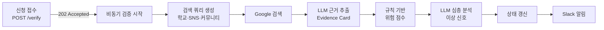

# Club-Verify

> 동아리 등록 신청이 들어오면 웹에서 근거를 모아 **위험 점수**를 매기고, 운영자에게 Slack으로 알려 주는 검증 서버


동아리 이름으로 위장한 포교·다단계 단체를 걸러 내기 위해 만들었습니다. 운영자가 신청서를 하나하나 검색해 보던 일을, 서버가 먼저 근거를 모으고 점수를 매겨 **확인이 필요한 신청만** 운영자에게 넘기도록 바꿉니다.

## 어떻게 동작하나요



1. **접수:** 신청을 저장하고 바로 `202 Accepted`를 돌려줍니다. 검증은 별도 스레드 풀에서 진행합니다.
2. **근거 수집:** 동아리 이름으로 쿼리 4~5개를 만들어 검색합니다.
   - 학교 공식 사이트 (`site:hanyang.ac.kr`)
   - 일반 검색 (`"동아리명" 한양대 동아리`)
   - 인스타그램, 에브리타임
   - 세부 카테고리가 있으면 카테고리 검색 추가
3. **근거 정리:** LLM이 검색 결과를 출처 유형, 활동 기간, 위험 키워드가 담긴 **Evidence Card**로 정리합니다.
4. **점수 계산:** 정해진 규칙으로 위험 점수를 계산합니다. 점수는 LLM이 아니라 규칙이 매깁니다.
5. **심층 분석:** LLM이 근거와 점수를 함께 보고 이상 신호와 종합 의견을 남깁니다.
6. **알림:** 결과를 Slack으로 보내고, 같은 결과를 API로도 조회할 수 있습니다.

## 위험 점수

근거마다 점수를 더하고 빼서 합산합니다. 신뢰할 근거는 점수를 낮추고, 의심스러운 근거는 높입니다.

| 신호 | 점수 | 조건 |
|---|---:|---|
| 학교 공식·학과 공지 출처 | **−40** | 학교 도메인에서 언급됨 |
| SNS 장기 활동 | **−25** | SNS 활동 기간이 6개월 이상 |
| 제3자 언급 | **−20** | 뉴스·커뮤니티·블로그에 1건 이상 |
| 검색 결과 부족 | **+25** | 근거 1건 이하이고 최근 3개월 내 신청 |
| 고위험 키워드 | **+30** (3개 이상이면 +40) | 포교·다단계 관련 단어 |
| 중위험 키워드 | **+15** | 고위험 키워드가 없을 때만 |
| 복제 콘텐츠 | **+15** | 같은 문구가 3곳 이상에서 반복됨 |
| 비공식 이메일 도메인 | **+10** | 대표 이메일이 학교 도메인이 아님 |

합산 점수에 따라 세 단계로 나눕니다.

| 점수 | 등급 | 처리 |
|---|---|---|
| 20 이하 | 🟢 `AUTO_APPROVE` | 자동 승인 후보 |
| 21 ~ 60 | 🟡 `PENDING_REVIEW` | 보류, 추가 서류 요청 |
| 61 이상 | 🔴 `MANUAL_REVIEW` | 운영자 직접 검토 |

> 키워드 목록은 [`RiskKeywords.java`](src/main/java/hanyang/erica/common/constant/RiskKeywords.java)에 있습니다.

## 외부 API가 실패하면

검증은 검색 API와 LLM API에 기대고 있어서, 실패를 기본값으로 가정하고 설계했습니다.

- **재시도와 서킷 브레이커:** Resilience4j로 검색은 최대 3회, LLM은 최대 2회까지 지수 백오프로 재시도합니다. 실패율이 50%를 넘으면 회로를 열어 잠시 호출을 멈춥니다.
- **LLM 근거 추출 실패:** 검색 결과에서 도메인으로 출처 유형만 추정해 최소한의 Evidence Card를 만들고, 점수 계산은 계속합니다.
- **LLM 심층 분석 실패:** 점수는 그대로 두고 "수동 검토 필요"를 기록합니다.
- **검증 전체 실패:** 신청을 `반려-운영자검토필요` 상태로 두고 Slack으로 오류를 알립니다. 실패한 신청이 자동 승인되는 일은 없습니다.

## API

### 검증 요청

```http
POST /api/v1/clubs/verify
Content-Type: application/json

{
  "clubName": "알고리즘 연구회",
  "category": "CENTRAL",
  "subCategory": "학술",
  "shortDescription": "알고리즘 문제를 함께 푸는 동아리",
  "fullDescription": "매주 스터디와 교내 대회를 진행합니다.",
  "representativeEmailDomain": "hanyang.ac.kr"
}
```

`category`는 `CENTRAL`(중앙), `UNION`(연합), `COLLEGE`(단과대), `DEPARTMENT`(학과) 중 하나입니다.

```json
{
  "applicationId": 1,
  "clubName": "알고리즘 연구회",
  "status": "VERIFICATION_IN_PROGRESS",
  "statusDescription": "검증진행중",
  "message": "검증이 시작되었습니다. 결과는 Slack으로 알림됩니다."
}
```

### 검증 결과 조회

```http
GET /api/v1/clubs/{applicationId}/verification
```

```json
{
  "applicationId": 1,
  "status": "AUTO_APPROVED",
  "totalRiskScore": -60,
  "riskLevel": "AUTO_APPROVE",
  "riskLevelDescription": "자동승인후보",
  "scoreBreakdown": "{\"학교공식/학과공지 출처\":-40,\"제3자 언급\":-20}",
  "llmObservation": "학교 공식 공지와 커뮤니티 언급이 확인됩니다.",
  "anomalySignals": [],
  "verifiedAt": "2026-01-18T15:53:20"
}
```

### 신청 상세 조회

```http
GET /api/v1/clubs/{applicationId}
```

## 실행하기

**필요한 것:** JDK 21

```sh
export GOOGLE_API_KEY=...        # Google Custom Search API 키
export GOOGLE_CX=...             # 검색 엔진 ID
export GEMINI_API_KEY=...
export SLACK_WEBHOOK_URL=...     # 없으면 알림만 빠집니다

./gradlew bootRun
```

- 기본 프로필은 `local`이고, 인메모리 H2를 씁니다. DB 콘솔은 `http://localhost:8080/h2-console`에 있습니다.
- MySQL을 쓰려면 `SPRING_PROFILES_ACTIVE=prod`와 `DB_USERNAME`, `DB_PASSWORD`를 지정하세요.
- LLM은 Gemini(`gemini-2.5-flash-lite`)가 기본입니다. Claude 클라이언트도 `LlmClient` 구현체로 들어 있어서 바꿔 끼울 수 있습니다.

```sh
./gradlew test
```

## 구조

```
src/main/java/hanyang/erica
├── api                  # 컨트롤러, 요청/응답 DTO, 예외 처리
├── domain
│   ├── club             # 동아리 신청, 상태
│   ├── evidence         # Evidence Card 수집·저장
│   └── verification     # 점수 계산, 검증 흐름(Orchestrator)
├── infrastructure
│   ├── search           # Google Custom Search, 쿼리 생성
│   ├── llm              # Gemini / Claude 클라이언트, 프롬프트
│   └── notification     # Slack 웹훅
├── common               # 위험 키워드, 학교 도메인
└── config               # 비동기 스레드 풀, WebClient, JPA
```

## 기술 스택

| 분류 | 사용 |
|---|---|
| Language | Java 21 |
| Framework | Spring Boot 3.5 (Web, WebFlux `WebClient`, Data JPA, Validation) |
| DB | MySQL, H2 (local) |
| 외부 API | Google Custom Search, Gemini, Claude, Slack Webhook |
| 안정성 | Resilience4j (Retry, CircuitBreaker) |
| Test | JUnit 5, MockMvc, MockWebServer |
